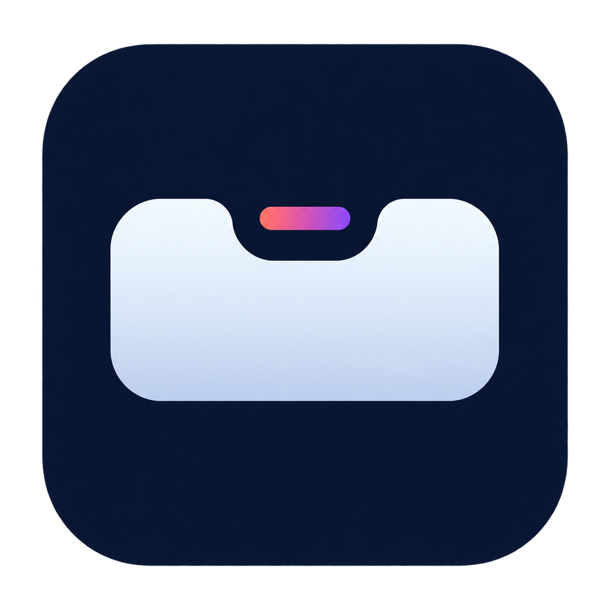

# Mac Island

**English** · [简体中文](README.zh-CN.md)



See the status of your coding assistants at the top of your Mac, or in a movable
floating Island. Expand it when you need context and return to the original
client to continue working. Mac Island stays silent.

**Development preview. An official signed installer has not been released.**
Signing, notarization and installation/upgrade acceptance are separate from
source publication. Upstream Ping Island installers are not this product.
See [release readiness](docs/mac-island-release-readiness.md).

[Website · English](https://samadhi-chi.github.io/mac-island/en/index.html) ·
[网站 · 简体中文](https://samadhi-chi.github.io/mac-island/index.html) ·
[Website source](site/index.html)

This repository starts from a reviewed source snapshot. Earlier development
history is retained in a private archive; see [source history](docs/source-history.md)
and the [publication review](docs/public-readiness-2026-10-31.en.md).

## What it does

- Observes supported local Codex, Cursor, Claude Code, OpenCode, Hermes and DeepSeek Harness activity.
- Shows current sessions, native titles, attention states and optional details.
- Returns to a client through an explicit open action, with feedback distinguishing a located terminal, a sent request, an app-only activation and failure.
- Keeps bounded recent routing metadata, with retention and clear controls.
- Shares session and privacy behavior between the top-of-screen and floating surfaces.

Mac Island does not send messages, answer questions, approve actions or start
agent tasks. Telemetry, automatic updates and remote SSH services are disabled.
CLI continuation supports preview and command copy; execution is not certified.
See [continuation boundaries](docs/session-continuation.md).

## Getting started

The first-run guide introduces display position, integrations and existing
connection health. It does not install hooks or request system permissions.
Install a supported integration explicitly in Settings when you need it.

The separate monitor demonstration uses labeled synthetic data. It does not
start client tasks or add examples to your current sessions or recent records.

The list opens on **Current sessions**. **Recent records** is a secondary entry.
Titles come from the original client; unavailable names are identified rather
than replaced by a folder name or conversation text. Click a row to select it;
use the open button or Enter to request navigation. Acceptance of a URL by macOS
does not confirm that the correct conversation appeared.

## Screen privacy

| Setting | Visible information |
| --- | --- |
| Status only | Client and generic state; hides titles, Bot names, content, paths and IDs |
| Titles | Adds native titles or Bot names; hides conversation and activity text, paths and IDs |
| Details | Shows available local progress; full paths and native IDs remain in explicit detail views |

New installations default to Titles. Existing installations preserve the prior
detail preference during migration. Temporary hiding switches both Island
surfaces to status only and restores your chosen level afterward. It does not
cover other applications or stop observation.

## Muse, Grok Bot and Dot

Muse 4.1 / 6.0 and Grok Bot 0.68.1 are experimental current-interface sources,
disabled by default. Each requires explicit opt-in and Accessibility permission.
One card represents one currently identifiable Bot context. Muse 6.0 reads names
only from its verified English layout; Muse 4.1 Activity entries stay inside the Bot card.

Background Bot discovery, exact running state and chat recovery are not
guaranteed. Unknown activity is excluded from running counts and recent records.
Unsupported versions, missing permission and unreadable interfaces show an
explicit status. Dot has an app entry only; ordinary Codex sessions remain Codex.
See [experimental source boundaries](docs/personal-agent-observation.md).

## Privacy and support

Native titles and conversation content are displayed in memory. Recent routing
metadata defaults to seven days and 200 records, with 24-hour / 100-record,
session-only and disabled options. Clearing recent records does not delete
history in the original client or separate association and quota caches.

The app includes offline help, privacy information and full third-party notices.
User-triggered diagnostic summaries contain versions, fixed health states and
failure categories, without client configuration, raw logs, project paths,
session titles, conversations or credentials. Nothing is sent automatically.

If sessions are missing, check that only one Mac Island instance is running, then
review integration health and the last successful read. Reconnect affects only
Island's observation connection. See [English help](PingIsland/Resources/Legal/MacIsland-Help-en.md)
and [privacy information](PingIsland/Resources/Legal/MacIsland-Privacy-en.md).
Use the [support guide](site/en/support.html) for ordinary issues and
[SECURITY.md](SECURITY.md) for security reports. Never post private conversations
or unreviewed diagnostic archives publicly.

## Development

Mac Island is an independent fork of [Ping Island](https://github.com/erha19/ping-island)
under Apache 2.0. Use Xcode 26+ and Swift 6.2+; CI uses Xcode 26.3.
Open `PingIsland.xcodeproj` and select the `MacIsland` scheme.

```sh
git clone https://github.com/Samadhi-Chi/mac-island.git
cd mac-island
./scripts/test.sh
```

The gate checks source formatting and static pages, release fixtures, Prototype
tests, the unsigned Release build, bundled notices and selected product tests.
`BUILD_ROOT` selects a build directory; `BUILD_JOBS` defaults to 2.
Results are retained in `$BUILD_ROOT/TestResults/`. Development tests do not
certify actual client compatibility, permissions, sleep/wake or distribution.

macOS 14+ is the deployment target. Minimum-OS and Intel hardware acceptance
remain pending. Local signing settings belong in ignored `Config/Local.xcconfig`;
never commit credentials or machine-specific signing identities.

Read [CONTRIBUTING.md](CONTRIBUTING.md) for Issue, branch, PR and final-head CI
requirements, and [AGENTS.md](AGENTS.md) for implementation boundaries. Build and
test commands do not install, sign, notarize or publish the app. App Store
distribution remains a separate evaluation.

## Origins and licenses

[LICENSE.md](LICENSE.md) · [NOTICE](NOTICE) ·
[Third-party notices](docs/third-party-notices.md) · [App icon](docs/design/mac-island-app-icon.md)

The original [English](docs/history/upstream-readme.md) and
[Chinese](docs/history/upstream-readme.zh-CN.md) descriptions are historical
references. They do not define this fork's enabled features, downloads or support.
Current behavior is governed by `MacIslandProductPolicy`.
