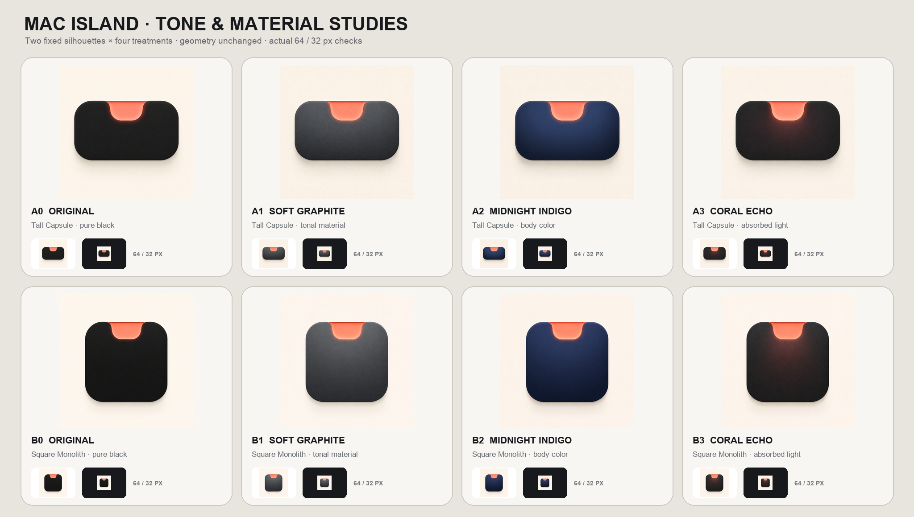
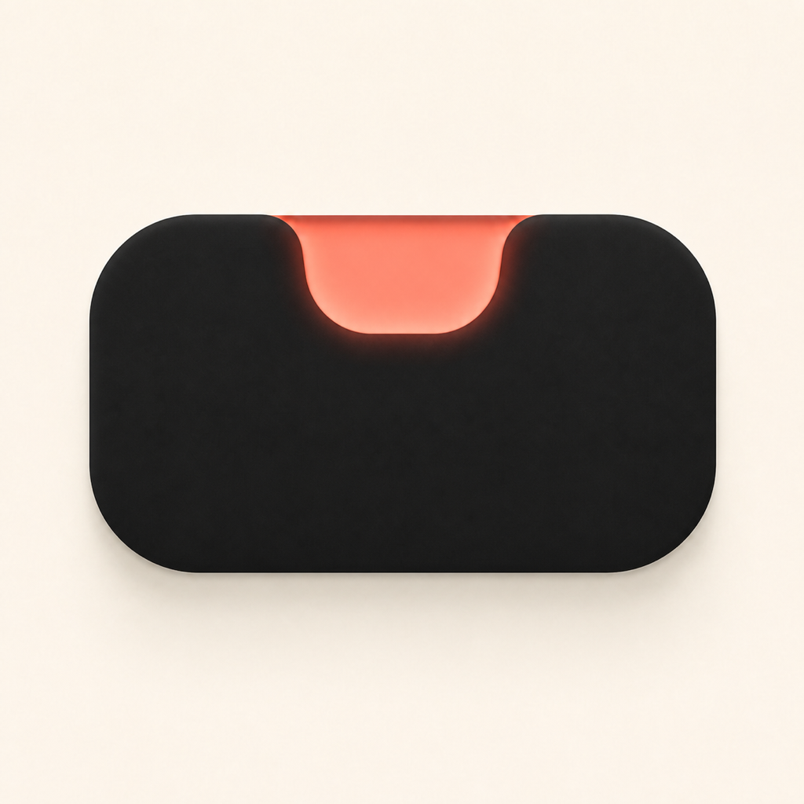
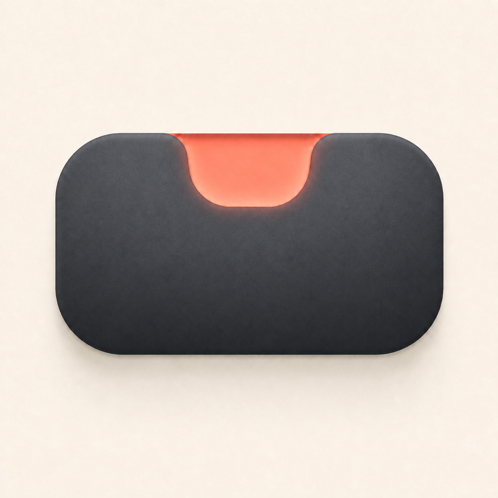
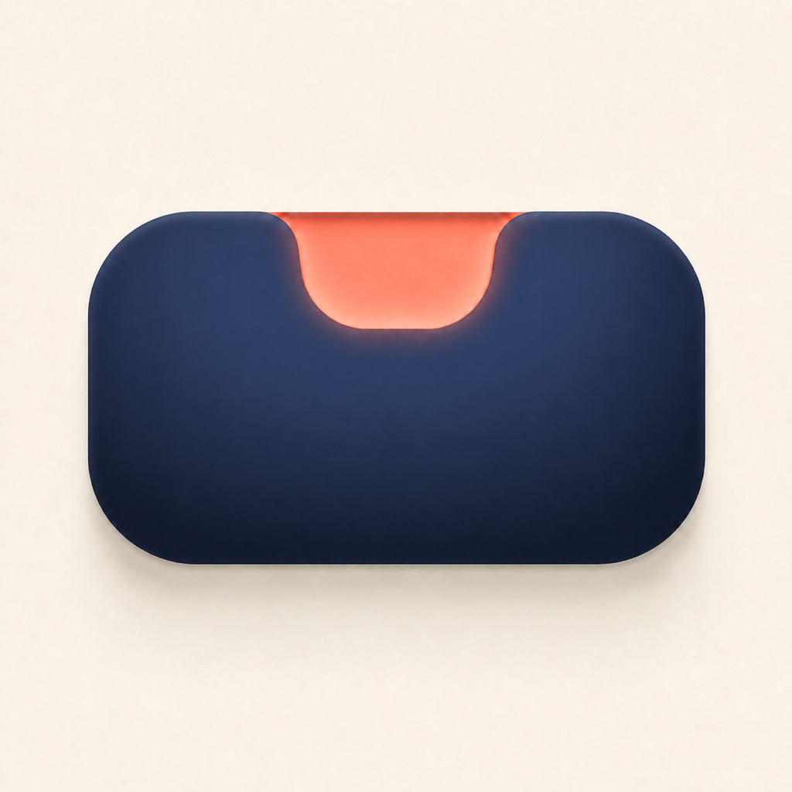
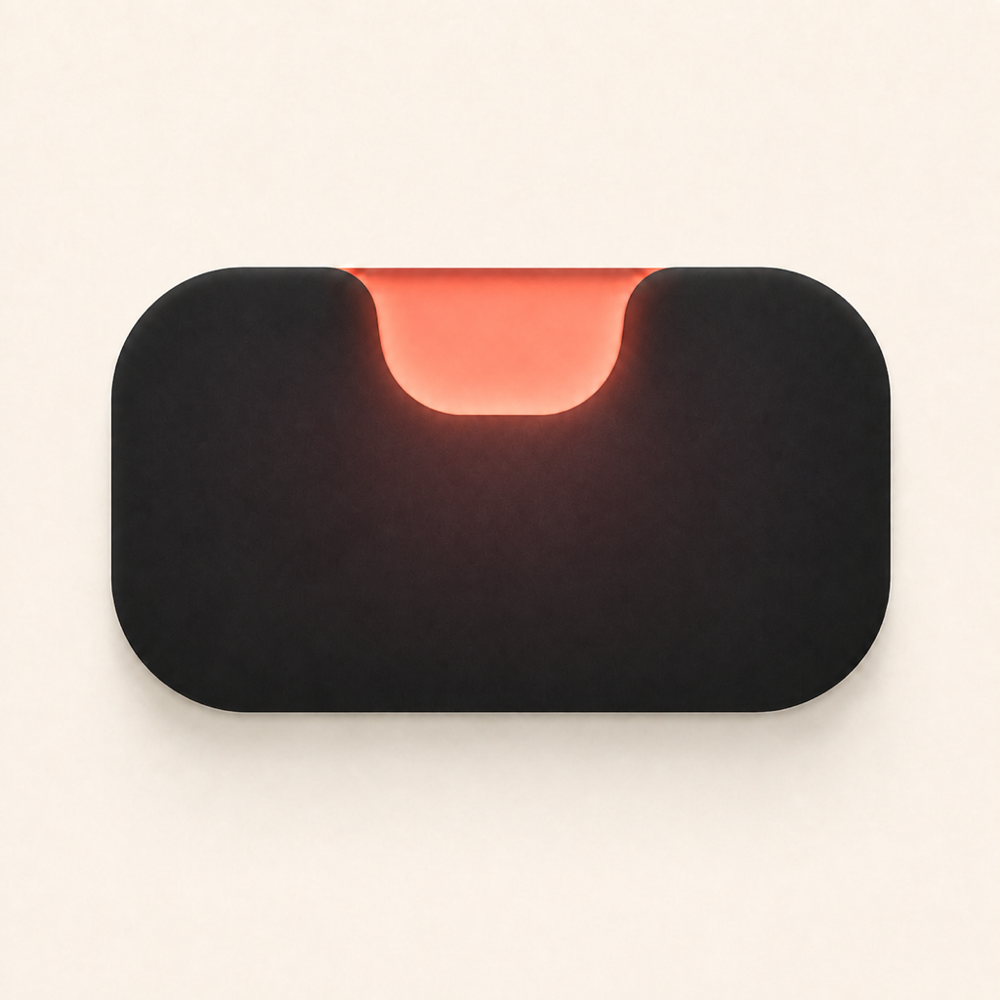
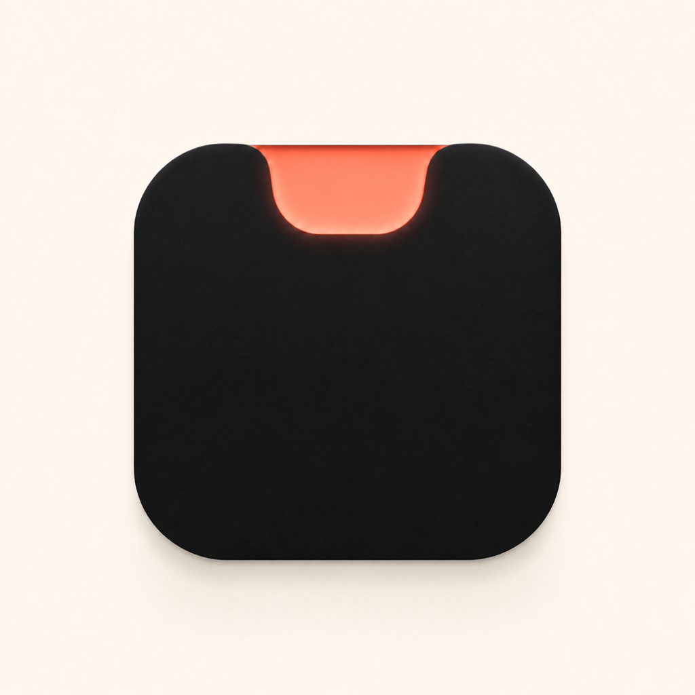
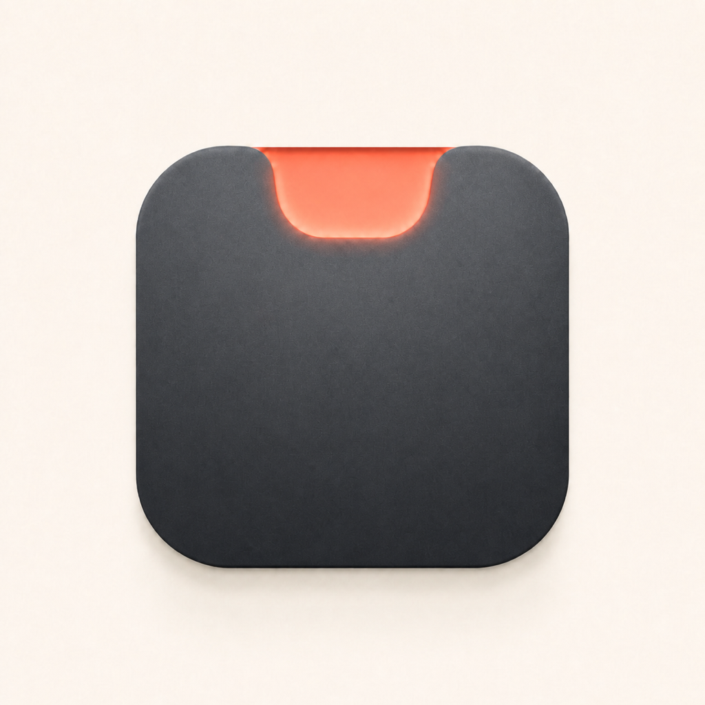
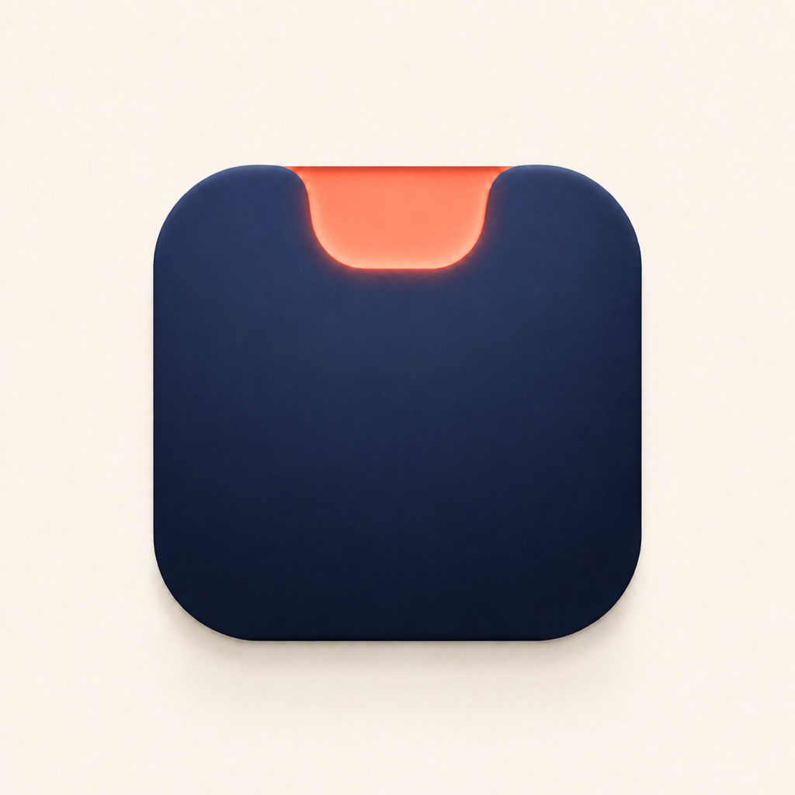
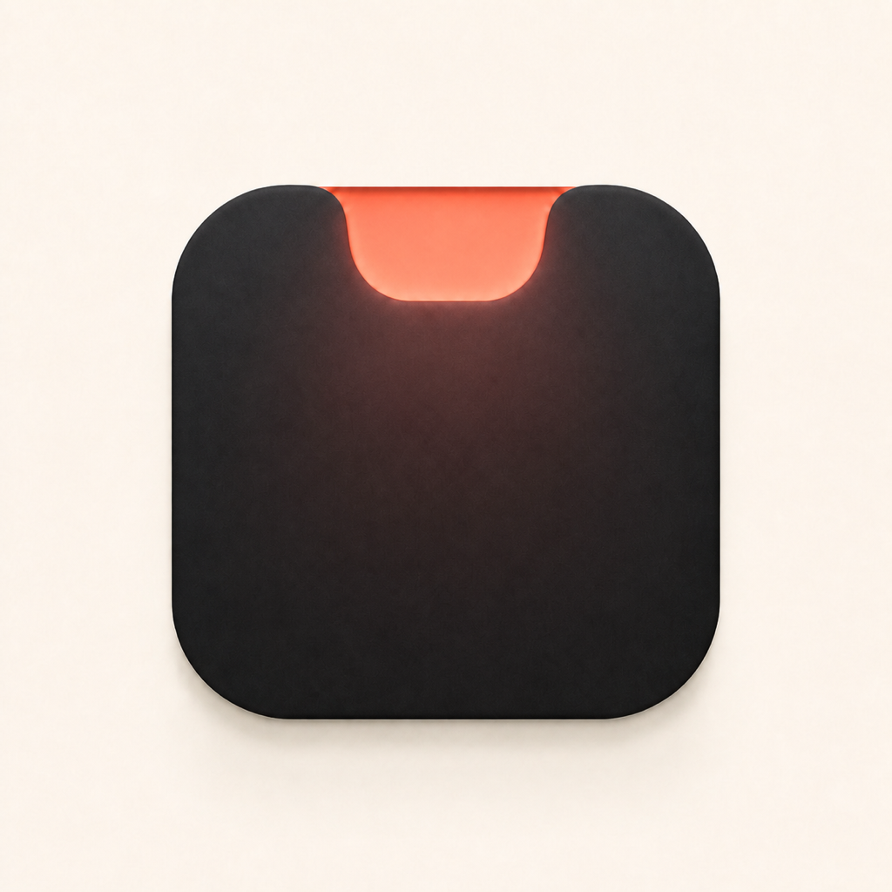

# Mac Island · Notch Pulse 色彩与材质补偿实验

日期：2026-08-11  
状态：**A3 · Tall Capsule / Coral Echo 已正式采用**，并写入 Mac Island 的 `AppIcon` 与本地 Release 包。

## 正式采用

- 选定源图：[`03A-tall-coral-echo.png`](./03A-tall-coral-echo.png)
- 正式图标集：`PingIsland/Assets.xcassets/AppIcon.appiconset`
- 工程绑定：四个 App 构建配置均使用 `ASSETCATALOG_COMPILER_APPICON_NAME = AppIcon`
- 本地成品：`releases/local-a3/MacIsland-0.26.0-67-A3-adhoc.zip` 与 `.dmg`
- 完整替换、验证与回滚信息见 [`PROMOTION.md`](./PROMOTION.md)

## 问题判断

当主体从横向胶囊变高后，纯黑区域的面积迅速增加，但纯黑内部几乎没有明度、色相或光线变化，视觉注意力只能停留在轮廓和珊瑚缺口上，因此中部容易显得“少了什么”。

本轮没有增加图案，而是用三种更克制的方式补偿：

1. **Soft Graphite**：提高暗部明度并加入极弱的矿物质感。
2. **Midnight Indigo**：把纯黑换成低饱和午夜靛蓝，利用与珊瑚色的冷暖互补。
3. **Coral Echo**：保留近黑主体，让缺口的珊瑚光在主体上半部留下很弱的色彩回声。

> 最终选择：采用本页原始 A3 珊瑚回声版本。此前的 [Codex 蓝色版本](../2026-08-11-selected-a3-blue/README.md) 保留为归档候选，不进入本次正式包。

## A · Tall Capsule

### A0 · Original

纯黑最直接，但中部面积扩大后显得较空。

### A1 · Soft Graphite

最稳妥的修正。仍然是中性色，只是从“黑色剪影”变成了“可触摸的深灰实体”。

### A2 · Midnight Indigo

色彩身份最完整。冷靛蓝与暖珊瑚形成互补，同时仍保持开发工具应有的安静和专业。

### A3 · Coral Echo

保留黑色印象，但用光线把缺口和主体连接起来。比原版有层次，也比直接换色更克制。

## B · Square Monolith

### B0 · Original

方形体块稳定，但纯黑面积最大，因此“空”的感受更明显。

### B1 · Soft Graphite

材质最清楚，适合希望图标像真实工业对象的路线。

### B2 · Midnight Indigo

最能缓解大面积暗色带来的压迫，也让方形轮廓显得更轻、更空间化。

### B3 · Coral Echo

气氛最强，但暖色区域也最容易被理解成热量或余烬，后续需要控制强度。

## 评审阶段建议（已由 A3 最终选择覆盖）

- **综合首选：A2 Tall Capsule + Midnight Indigo**。保留 Mac Island 的横向身份，同时解决黑色过重的问题。
- **中性首选：A1 Tall Capsule + Soft Graphite**。如果不希望品牌出现明显蓝色，这是最安全的修正。
- **方形首选：B2 Square Monolith + Midnight Indigo**。适合希望在 Dock/Finder 中更像完整 App Icon 的路线。

暂时不建议增加文字、点、线、波形或第二个符号。当前缺失的是内部层次，不是信息；加入新符号会削弱缺口本身的品牌识别。
