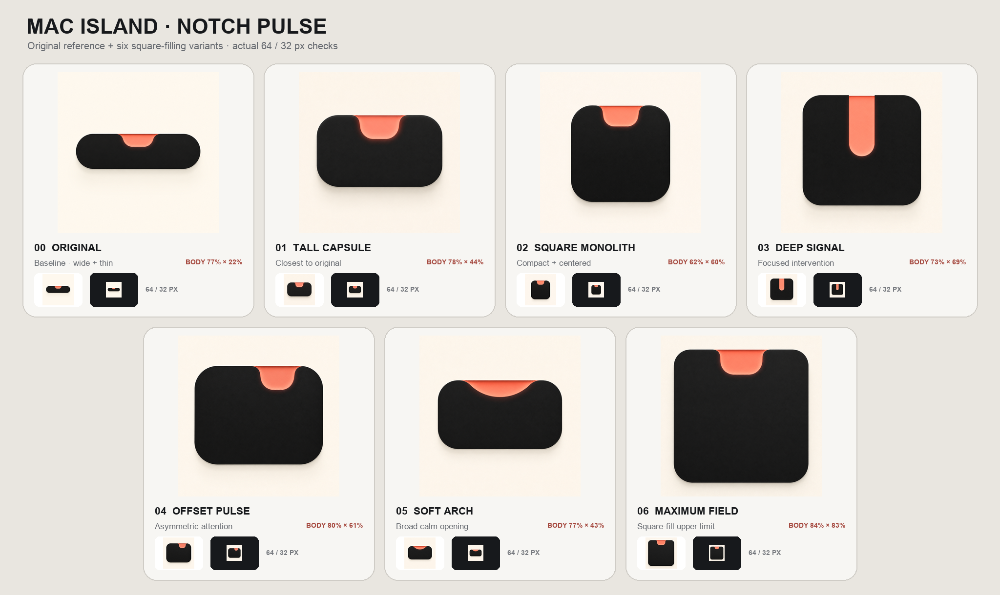
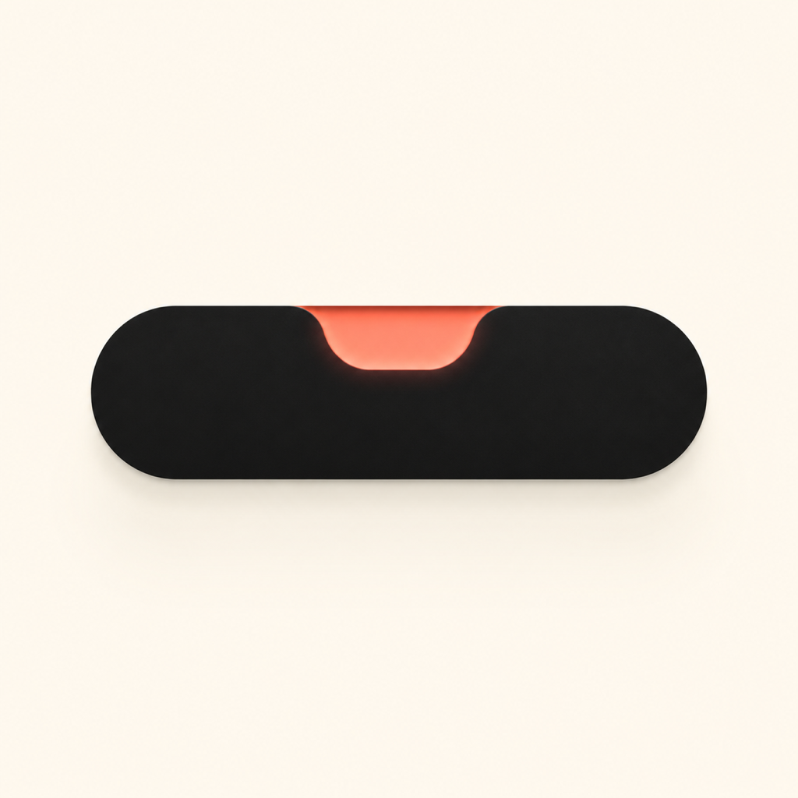
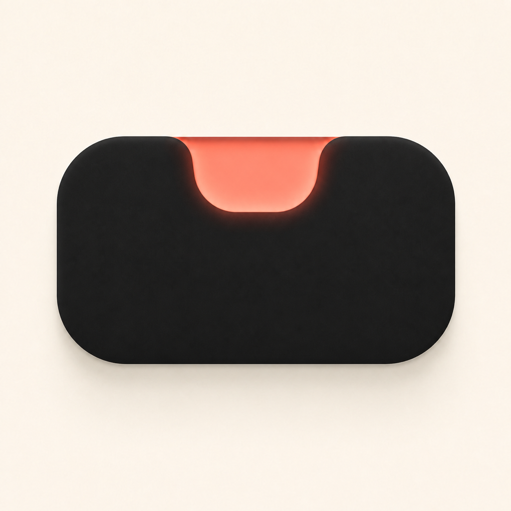
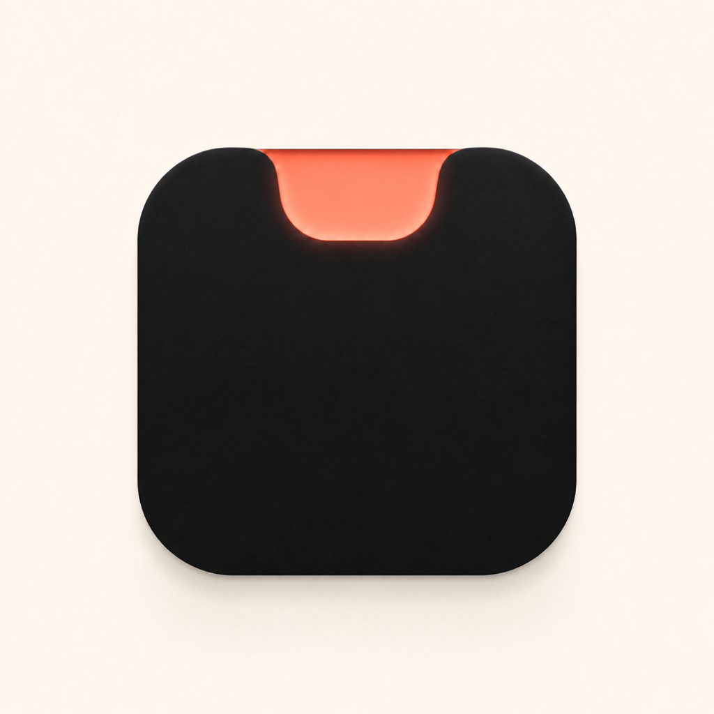
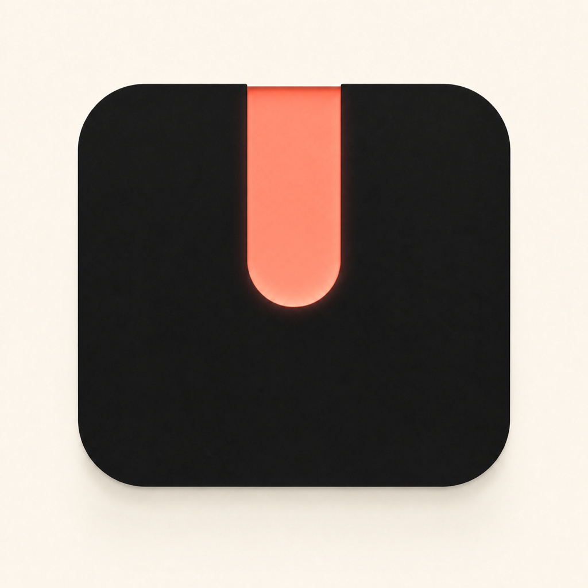
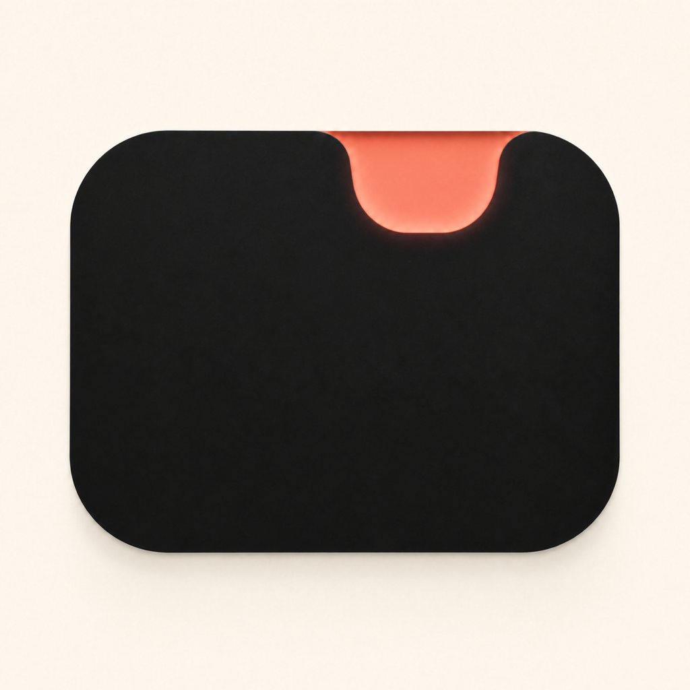
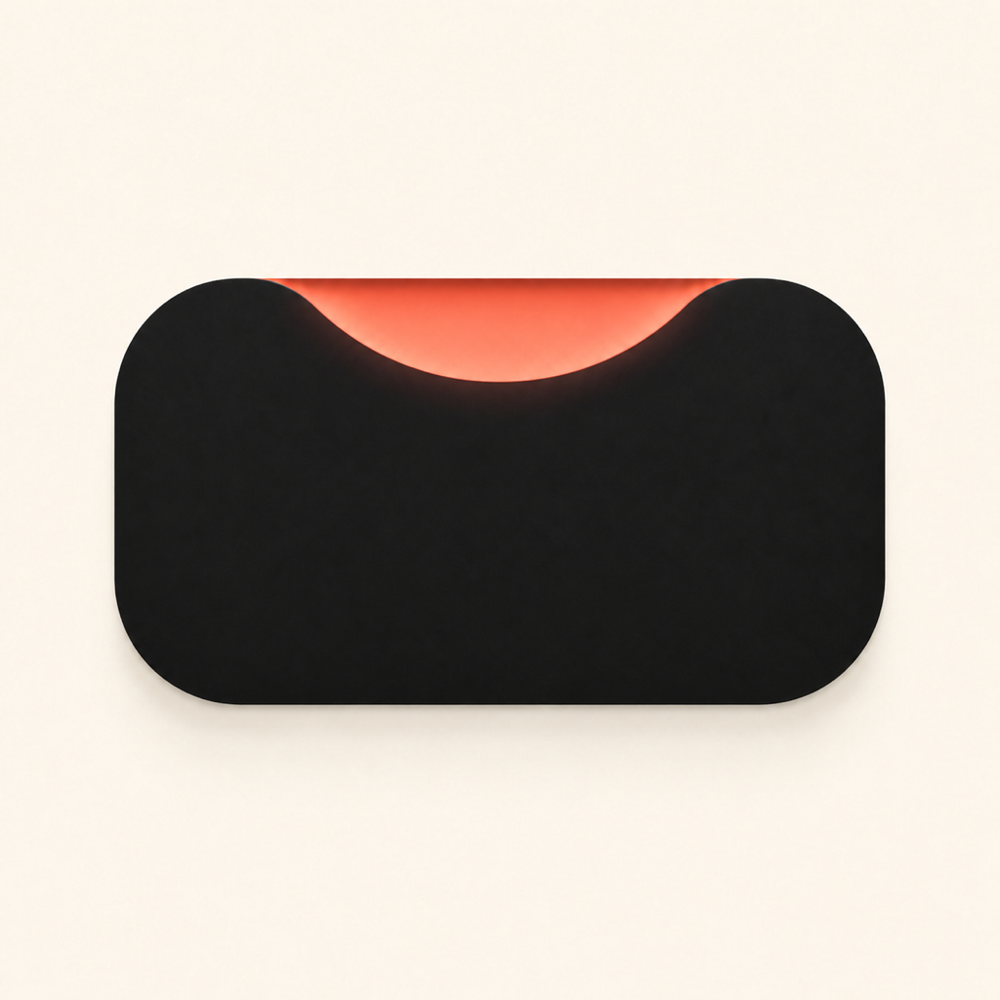
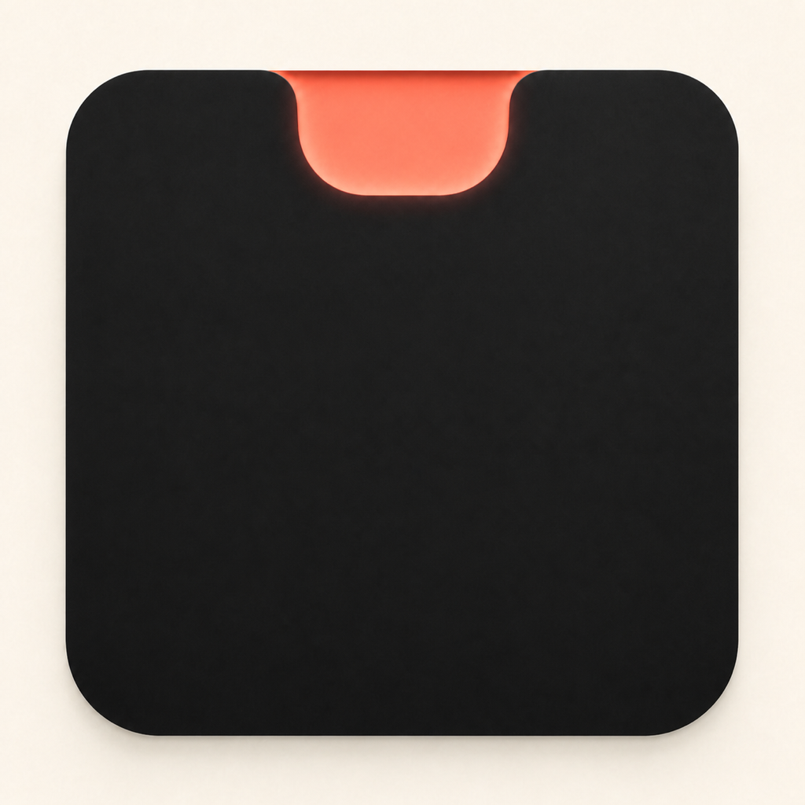

# Mac Island · Notch Pulse 方形占幅探索

日期：2026-08-11  
状态：概念评审稿；保留原版，未修改正式 `AppIcon` 或 Xcode 工程。

本轮只解决一个问题：保留 01 Notch Pulse 的象牙白、哑黑实体、珊瑚色缺口和极简质感，同时让主体更充分地占据正方形画布。

> 01 Tall Capsule 与 02 Square Monolith 的后续探索：[色彩与材质补偿 2×4 对照实验](../2026-08-11-notch-pulse-tone-studies/README.md)

## 00 · Original Reference / 原版基准

- 暗色主体包围盒约为画布的 **77% × 22%**。
- 优点是最像真实 Mac 顶部岛体；问题是垂直方向留白过多。

## 01 · Tall Capsule / 高胶囊

- 暗色主体包围盒约为 **78% × 44%**。
- 最忠于原版，只把主体变高、端部变得更克制。
- 风险最低，也是从现有方向继续精修最自然的一张。

## 02 · Square Monolith / 方形巨石

- 暗色主体包围盒约为 **62% × 60%**。
- 用近方形体块代替横向岛体，整体更加集中、安静。
- 左右留白仍较多，但在 Dock 和 Finder 中会显得更稳。

## 03 · Deep Signal / 深信号

- 暗色主体包围盒约为 **73% × 69%**。
- 用窄而深的珊瑚切口强化“需要人介入”的信号。
- 品牌记忆最强，但也可能产生插槽、磁铁或开关联想。

## 04 · Offset Pulse / 偏心脉冲

- 暗色主体包围盒约为 **80% × 61%**。
- 保留原版 U 形缺口，但把信号轻微右移，暗示某一个会话正在请求注意。
- 占幅与独特性最平衡，是本轮最值得继续发展的方向。

## 05 · Soft Arch / 柔和拱口

- 暗色主体包围盒约为 **77% × 43%**。
- 把小缺口改成宽而浅的单一圆弧，气质更加柔和、编辑化。
- 仍保留较多上下留白，也需要防止被读成笑脸或地平线。

## 06 · Maximum Field / 最大占幅

- 暗色主体包围盒约为 **84% × 83%**。
- 几乎占满安全区域，是判断“铺满正方形”上限的压力测试版本。
- 小尺寸最有重量，但已经接近通用圆角方形图标；后续应稍微回收至 78%–82% 高度。

## 当前建议

- **01 Tall Capsule**：保守路线，最大限度保留你喜欢的原版气质。
- **04 Offset Pulse**：平衡路线，占幅、产品含义和独特性最好。
- **06 Maximum Field**：极限路线，用来确定你能接受的最大视觉重量。

如果进入下一轮，建议只在 01、04、06 中选择一张，再精确调整主体高度、缺口宽度和珊瑚光强，不继续增加新造型。

说明：占幅数字是以近黑色主体像素估算的包围盒比例，只用于本组相对比较，不是正式光学网格。
