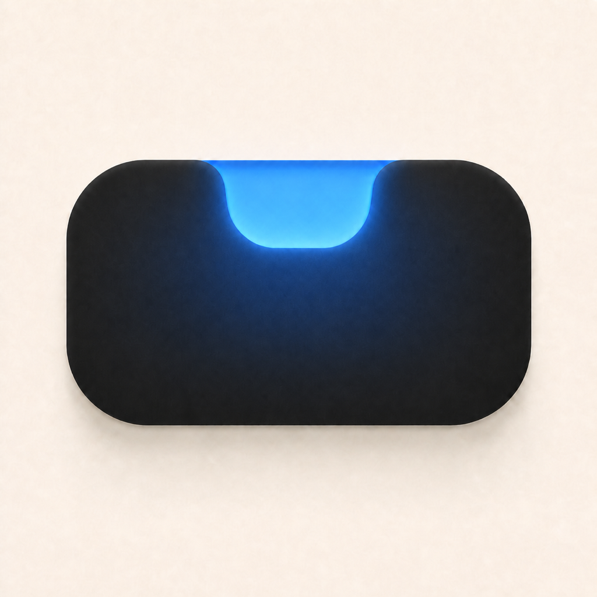

# Mac Island · Selected A3 Blue Echo

日期：2026-08-11  
状态：当前选定概念；尚未写入正式 `AppIcon`，未修改 Xcode 工程。

## 选择

沿用 **A3 Tall Capsule + Absorbed Echo**：近黑色高胶囊主体、顶部 U 形发光缺口，以及从缺口进入主体上半部后逐渐消失的内部余晖。

本版只把原来的橙色体系替换为 Mac Island 当前 Codex 可视化使用的蓝色体系：

- `#0A73F7`：Codex glyph 深钴蓝。
- `#22C7EF`：Codex glyph 亮青蓝。
- `#54ABFF`：Codex 状态 glow。
- `#2E7DE6`：Codex 状态 outer glow。
- `#173D87`：Codex palette 的深蓝 detail，用于主体内部余晖。

颜色依据：

- `PingIsland/UI/Components/MacIslandClientGlyphView.swift` 第 61–62 行。
- `PingIsland/UI/Views/NotchHeaderView.swift` 第 78–87 行。

## 设计判断

- 蓝色比橙色更贴近当前 Codex 会话、像素 glyph 和状态提示的实际视觉语言。
- 图标采用蓝色作为稳定品牌色；App 内的橙色仍可保留给 intervention、warning 等语义状态，两者不冲突。
- 没有把整个主体改成蓝色，只让蓝色集中在缺口和余晖，因此仍保留 Mac 顶部黑色岛体的核心识别。
- 亮青蓝核心在 32 px 下仍能识别；正式出图时应避免继续提高发光强度。

## 文件

- `00-a3-coral-reference.png`：改色前 A3。
- `01-a3-mac-island-blue.png`：当前选定蓝色方案，1024 × 1024 sRGB。
- `comparison.png`：改色前后及实际色板对照。

本目录是设计选择记录，不代表已经获得正式资源替换或发布授权。
