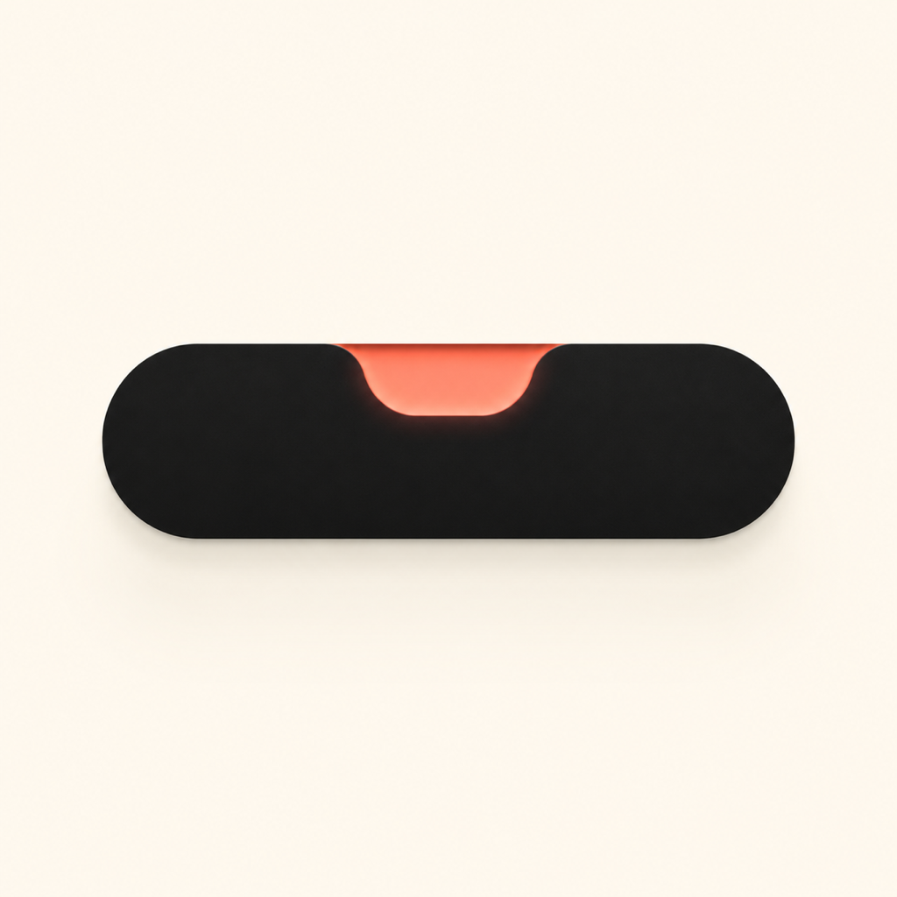
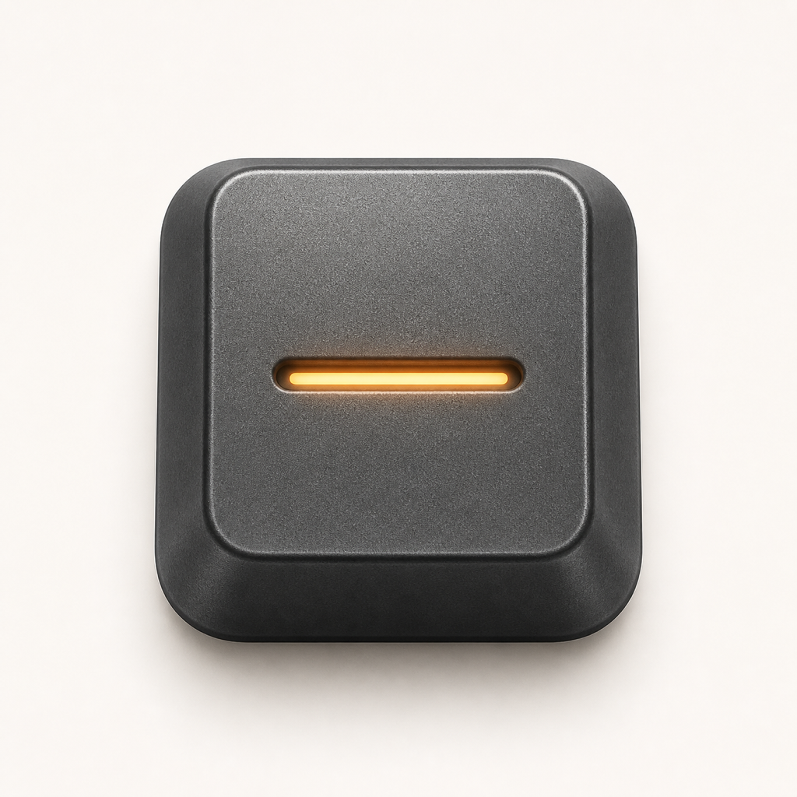

# Mac Island · App Icon Concepts V2

日期：2026-08-11  
状态：概念候选，仅用于评审；未写入正式 `AppIcon`，未修改 Xcode 工程。

产品语义：本地、安静地观察 AI 编码会话；平时隐身，只在需要人介入时浮现。

## 01 · Notch Pulse / 缺口脉冲

> 后续方形占幅探索：[原版 + 6 个 Notch Pulse 变体](../2026-08-11-notch-pulse-variants/README.md)

- 设计语言：瑞士式极简、强负形、黑色胶囊 + 珊瑚色状态切口。
- 产品映射：直接对应 Mac 顶部岛形界面和“异常才出现”的单一信号。
- 优点：产品辨识最直接；轮廓非常简单；适合菜单栏与深浅色环境。
- 风险：横向比例在小尺寸图标里可能显得偏空，需要下一轮进一步压紧构图。

## 02 · Command Key / 指令键

- 设计语言：工业设计、触感 3D、石墨键帽 + 琥珀状态槽。
- 产品映射：把“等待人确认”做成一个安静但可按下的物理控制件。
- 优点：成熟、可信、质感最好；与开发工具场景自然相连。
- 风险：如果后续加入键盘符号，会迅速落入通用效率工具；应保持无字形。

## 03 · Agent Relay / 智能体接力

- 设计语言：几何系统图、扁平高饱和、连续路径与节点。
- 产品映射：多个 AI 会话经过 Mac Island 汇聚为一个中心状态。
- 优点：能表达多会话、多智能体；颜色活跃，适合更年轻的品牌方向。
- 风险：网络与自动化工具的联想较强，独占性弱于 02 与 04。

## 04 · Intervention Tab / 介入标签

- 设计语言：空间玻璃、建筑式几何、黑色底座 + 透明升起标签。
- 产品映射：岛体保持安静，只有橙色信号需要处理时才“升起”。
- 优点：叙事完整，兼具 Mac 的物理感和 visionOS 式材质；状态点很明确。
- 风险：可能被理解为硬件指示灯；后续需用动效强化“浮现—解决—收回”。

## 05 · Night Beacon / 夜间信标

- 设计语言：编辑插画、夜色大留白、金色弧光 + 单一蓝点。
- 产品映射：本地工具整晚守候，只在关键时刻发出一道信号。
- 优点：克制、情绪独特，不像常见开发者工具；适合品牌故事与官网视觉。
- 风险：产品功能最不直观，也可能被误读为景观或海洋类应用。

## 初筛建议

- 首选：**02 Command Key**。最成熟，也最像一个可以长期使用的 macOS 工具品牌。
- 次选：**04 Intervention Tab**。产品叙事最完整，适合继续做状态动效。
- 保留对照：**01 Notch Pulse**。适合作为更极简、更直接的备选。

评审时请先看 `contact-sheet.png`，再单独打开 1024 px 原图检查材质与边缘。正式采用前仍需完成 64/32/16 px 小尺寸重绘、系统圆角遮罩预览和商标近似检索。
